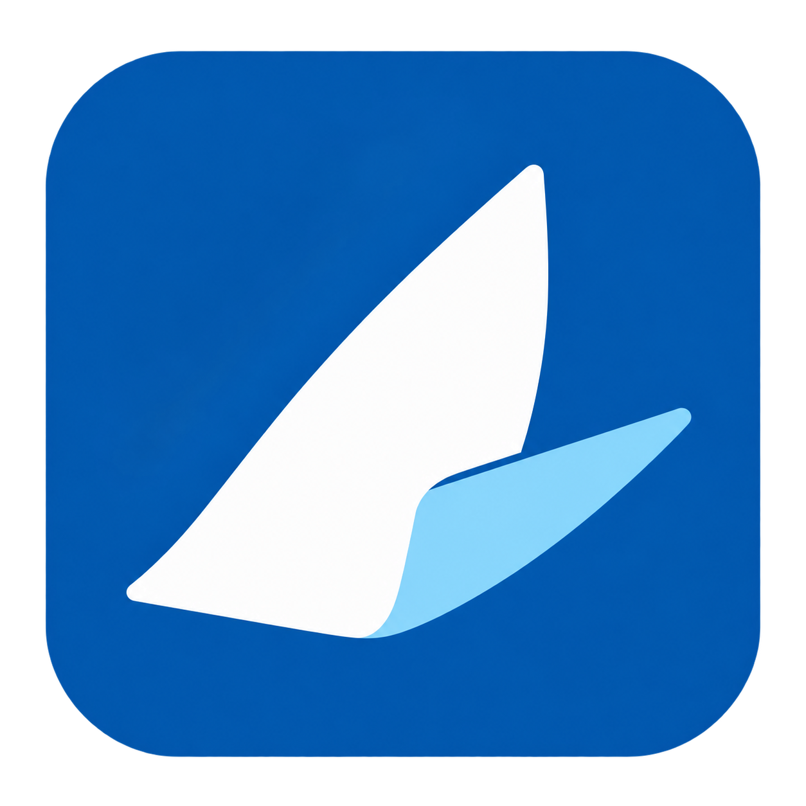

# 序舟品牌与图标

生成日期：2026-10-21（北京时间）。

## 产品名称与定位

- 名称：序舟。
- 定位：AI 工程工作台。
- 宣传语：让想法有序落地。

“序”代表整理资料、厘清需求、组织讨论和编排执行步骤；“舟”代表承载工程、把想法持续推进为可交付的成果。名称覆盖当前的工程管理、文档与需求分析、对话、浏览器操作、命令执行、测试验收和文件管理，也为后续工程能力保留空间。

命名时做了公开检索，避开已有工作管理应用[序桥](https://apps.apple.com/tw/app/%E5%BA%8F%E6%A1%A5/id6805549465)及已有 AI 产品相关名称[澄序](https://clariseqtech.com/)。

## Logo 设计



图形由向前展开的白色主帆和浅蓝前帆组成，轮廓同时呼应折叠文档与向前航行，表达从信息到行动的转化。蓝色圆角底板使浅色、深色背景上的视觉识别保持一致。图形不含文字，以便用于桌面、窗口和侧栏的小尺寸场景。

设计提示词使用钴蓝 `#0758AD`、白色 `#FFFFFF` 和浅蓝 `#9DDEFF` 作为目标配色。最终交付为带透明外边缘的 PNG 位图及其平台图标导出。

使用内置 imagegen 生成工具完成一轮生成、一轮表面与边缘清理，随后只做尺寸与格式导出。选定原图为 1254 × 1254 的 RGBA PNG。

## 项目资产与接入

| 用途 | 资源路径（仓库根目录起） |
| --- | --- |
| 原尺寸母版、桌面窗口 / Dock / 关于面板 | `frontend/apps/desktop/assets/brand/icon.png` |
| macOS 安装包应用图标 | `frontend/apps/desktop/assets/brand/icon.icns` |
| Windows 安装包应用图标 | `frontend/apps/desktop/assets/brand/icon.ico` |
| 侧栏与窗口标题栏，128 × 128 PNG | `frontend/apps/agent-web/public/brand/icon.png` |
| 网页 favicon，64 × 64 PNG | `frontend/apps/agent-web/public/brand/favicon.png` |
| Apple touch icon，180 × 180 PNG | `frontend/apps/agent-web/public/brand/apple-touch-icon.png` |
| 本说明预览图 | `assets/logo.png` |

macOS 图标包含 16、32、64、128、256、512、1024 像素的对应显示倍率资源；Windows ICO 包含 16、20、24、32、40、48、64、128、256 像素共九档资源。

界面名称、窗口标题、原生菜单、关于面板、聊天助手名称、网页标题、应用描述、可选 Python 服务标题和打包产品名已统一。侧栏“我的工程”调整为 13px，与“全部工程”字号一致，字重为 600，取消原来的额外字距。

产品更名沿用已有 `appId`、`app.setName('Test Agent')`、用户数据目录、数据库文件名、自定义协议与本地偏好键。Electron 44.9.1 的 [macOS 系统密钥初始化代码](https://github.com/electron/electron/blob/v44.9.1/shell/browser/electron_browser_main_parts.cc#L597-L639)使用应用内部名称，因此继续保留这个身份。历史文档中的旧名称和数据路径仍可作为兼容记录查阅。

## 重新导出图标

在 macOS 上替换母版 PNG 后执行：

```bash
cd frontend
pnpm --filter test-agent-desktop brand:icons
```

此命令仅调用 macOS 自带的 `sips`、`iconutil` 和 Node.js 导出图标，不运行应用打包。Windows 打包直接读取已导出的 ICO。

## 验证

- `make frontend-check`：类型检查、格式检查和 109 项测试通过。
- `make frontend-build`：共享包与 UI 生产构建通过；品牌图片和 favicon 均包含在本地构建目录中。
- `make backend-check`：Ruff 与 3 项测试通过。
- `git diff --check`：通过。
- 浏览器预览确认侧栏品牌图、中文名称、分组字号及收起布局；截图位于忽略的 `test-results/brand/`。
- 已导出并检查 PNG、ICNS、ICO 文件格式。本次没有生成安装包，也没有验证安装包内的系统图标或旧版本升级流程。

## 生成提示词

工具模式：内置 imagegen；第二轮以第一轮图像为编辑目标，保留透明背景。

### 第一轮

```text
Use case: logo-brand.
Asset type: production-ready application icon for a Chinese macOS / Windows desktop product named 序舟 (an AI project workspace for turning documents and ideas into organized plans, conversations and executed tasks).
Primary request: design a single original, memorable minimalist logo: a folded sail / forward-moving paper vessel made from just two broad geometric folded surfaces. The broad white main sail has a clean diagonal fold and the smaller pale-cyan front surface suggests motion and the transformation of a document into action. Aim for one strong, highly legible silhouette at 24px, with carefully balanced negative space.
Scene/backdrop: one deep cobalt blue #0758AD rounded-square app tile, fully filled and opaque inside, centered on genuine transparent outside canvas. The tile should occupy about 88 percent of a square 1024-by-1024 composition, with a smooth continuous corner radius about 22 percent of tile width. The sail emblem sits optically centered within the tile, occupies about 60 percent of tile width, and uses white #FFFFFF and pale icy blue #9DDEFF.
Style/medium: exceptionally clean flat vector-like brand mark, crisp straight edges with subtly softened vertices, restrained two-tone geometry. Calm, capable, approachable professional developer productivity app identity.
Constraints: just ONE finished app icon, straight-on square view; no wordmark, no letters, no text, no diagram, no presentation board, no extra marks. No drop shadow, no texture, no bevel, no lighting effects, no 3D, no gradients, no tiny details, no generic AI sparkle or robot, no checkmark, no watermark. Preserve transparent pixels outside the rounded tile.
```

### 最终清理

```text
Use case: precise-object-edit / logo-brand.
Input image: edit target, the attached blue rounded-square sail logo.
Change only the finish and edge cleanliness: turn the existing design into a perfectly flat solid-color app icon. Keep exactly the same sail silhouette, composition, two folded pieces, proportions, tile placement and generous corner radii. Replace the tile fill with one absolutely uniform solid #0758AD, main sail pure #FFFFFF, small forward sail solid #9DDEFF. Remove EVERY trace of texture, mottling, gradients, lighting, shadows, blue flecks, stray pixels and roughness. The outer rounded-square edge must be mathematically clean with smooth antialiasing; every pixel outside the rounded tile must be fully transparent and clear. No texture at any zoom. The sail is a flat geometric symbol, not a lit object. One centered square app icon only, no typography, no new elements, no watermark.
```
